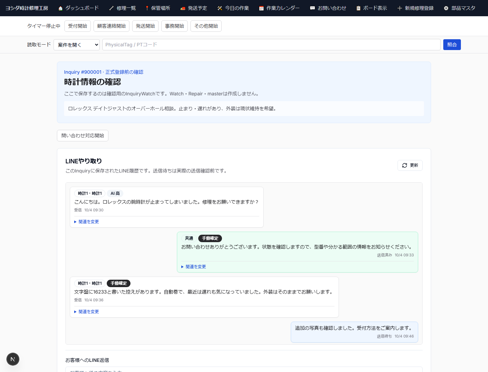

# 第6章 Inquiry / LINE会話 / 画像の保存

## 6.1 正本データの考え方

LINE問い合わせでは、原文・ファイル・AI分析・正式な時計情報を同じデータとして扱わない。

```text
LINE原文
  ├─ InquiryMessage
  └─ InquiryFile
       ↓
AI暫定分析
  └─ InquiryAiAnalysis / InquiryAiWatch / Candidate
       ↓
人が確認した受付前時計情報
  └─ InquiryWatch
       ↓
正式案件
  └─ Watch / Repair
```

この分離により、AIが推定を変更しても、LINE原文や人が確定した正式データを失わない。

## 6.2 Inquiry

InquiryはLINE問い合わせの業務単位である。1件のInquiryに複数のLINEメッセージ、複数画像、複数時計を含められる。

同一顧客が一度の問い合わせで時計を複数本相談する場合でも、問い合わせ全体と時計ごとの情報を分けて管理する。

## 6.3 InquiryMessage

`InquiryMessage` は保存済みLINE会話の正本である。

主な区分は次のとおり。

- INBOUND: 顧客から受信
- OUTBOUND: 実際のLINE Manager履歴で送信確認できたメッセージ

送信待ちOutboxはまだ `InquiryMessage` ではない。実際の送信が履歴照合で確認されて初めてOUTBOUNDメッセージを作成する。

## 6.4 InquiryFile

受信画像はR2へ保存し、`InquiryFile` がメタデータを保持する。

管理画面では、認証済みの同一origin APIを経由して短時間有効なR2読取URLへリダイレクトする。R2のraw object keyや署名URLをブラウザpayload・マニュアル・ログへ恒久保存しない。

## 6.5 LINEやり取り画面

Inquiryレビュー画面には「LINEやり取り」セクションがある。

ここでは次を確認できる。

- 受信テキスト
- 受信画像
- 送信済みメッセージ
- 送信待ちOutbox
- 各メッセージの関連時計分類
- LINE返信入力欄

直近最大200件を表示し、それ以前の履歴がある場合はその旨を表示する。

## 6.6 LINE返信の状態

管理画面の「LINE送信待ちに追加」を押しても、その時点ではLINE送信成功ではない。

```text
返信内容入力
    ↓
LINE送信待ちに追加
    ↓
LineManagerSendOutbox = APPROVED
    ↓
ローカルsender
    ↓
LINE ManagerへPOST
    ↓
Manager履歴照合
    ↓
CONFIRMED
    ↓
OUTBOUND InquiryMessage
```

画面上の「送信待ち」は、実際のLINE送信確認前である。

## 6.7 送信先の安全確認

LINE返信は、InquiryのLineUserとLINE Manager上のchatが検証済みである場合だけ送信intentを作成できる。

送信先が未確認の場合は画面に「LINE送信先の確認がまだ完了していません」と表示し、誤送信を防ぐ。

Customer名、表示名、本文の類似などを送信先の本人確認根拠にはしない。

## 6.8 複数時計のメッセージ分類

1件のInquiryに複数時計がある場合、LINEメッセージを次のscopeで分類できる。

- UNASSIGNED: どの時計か未特定
- COMMON: 問い合わせ内の時計全体に共通
- WATCHES: 特定の1本または複数本に関連

人が「この関連を確定」した分類はMANUALとして保存し、後続のAI分類が勝手に上書きしない。

Repairへ案件化した後は、この分類から導出された関連情報を使い、Repair側のLINEタブでも該当会話を追跡できる。

案件化後はCustomerのコミュニケーション画面で同じCustomerに紐づく複数Inquiryを横断して確認できる。CLOSEDのInquiryも履歴に残り、新しいInquiryに届いた相談を別Repairへ関連付けられる。メッセージのRepair関連付けは複数Repairにも対応し、未割当・一般連絡もCustomer全体の履歴から消さない。人が確定した関連付けはAIが上書きしない。

顧客一覧・顧客編集画面からコミュニケーション画面を開く。保存済みの新しいLINE原文を最大500件表示し、古い履歴がある場合はその旨を示す。関連付けるメッセージと同じ顧客のRepairを確認して分類を保存する。RepairのLINEタブは関連する会話を確認する入口であり、顧客全体の未割当や一般連絡はコミュニケーション画面でも確認する。

顧客画面のLINE返信は確認済み送信先を選び、本文を確認して「LINE送信待ちに登録」を押す。候補が複数ある場合は送信先を明示選択する。確認済みmappingまたは送信履歴を保存する既存Inquiryがない場合は送信できない。登録後はOutboxが`CONFIRMED`になるまで送信済みと扱わない。

CustomerまたはRepairに保存済みのAI要約・未対応事項・返信案が表示される場合も、元のInquiry全体の要約とRepair固有のbriefを区別する。新着や関連付け変更で古くなった返信案は再生成まで返信欄へ反映できない。案を反映しても送信は別の明示操作である。

## 6.9 内部メモとの区別

LINE返信欄へ入力した内容は、そのまま顧客向け送信内容になる。

内部メモをLINE返信欄へ入力しない。画面にも「ここに入力した内容はお客様へのLINE送信用です。内部メモではありません」と表示する。

## 6.10 画面で確認する項目



この画面では次を確認する。

1. 顧客からの受信メッセージ
2. 受信画像
3. 「未特定 / 共通 / 時計N」の分類badge
4. 送信待ちメッセージ
5. 送信済みメッセージ
6. LINE返信欄
7. 「LINE送信待ちに追加」ボタン

同じLINE利用者の初回Manager送信先mappingは、Inbox処理後と定期確認で自動照合される。照合根拠が一致しない・曖昧な場合は送信先未確認のまま止まるため、表示名で送信先を決めない。
