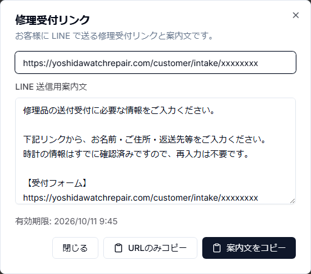
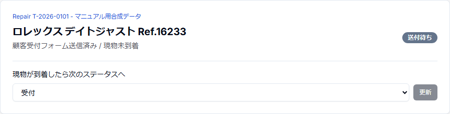
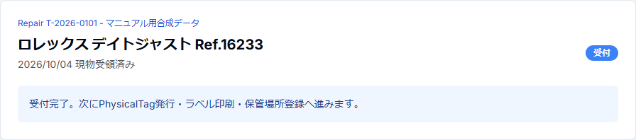

# 第8章 時計情報の確認とInquiryからRepairへの案件化

## 8.1 現在の案件化タイミング

現在のB2C Inquiryフローでは、現物が工房へ到着してから初めてRepairを作るのではない。

**顧客が専用受付リンクを入力・送信した時点でWatch / Repairを正式作成し、Repairを「送付待ち」として管理する。**

現物が到着した後にRepair statusを「受付」へ進める。

```text
Inquiryレビュー
    ↓
時計を「受付希望」にする
    ↓
お客様用受付リンクを発行
    ↓
LINEでリンク案内
    ↓
顧客が住所等を入力して送信
    ↓
Customer / Watch / Repair作成
    ↓
同じ受付のRepairを1つの共有ページにまとめ、LINE通常トークでURLを1回案内
    ↓
Repair status = 送付待ち
receptionDate = 未設定
    ↓
顧客が時計を発送
    ↓
工房へ現物到着
    ↓
Repair status = 受付
    ↓
PhysicalTag発行・保管場所登録へ
```

## 8.2 受付希望の時計を選ぶ

Inquiryレビュー画面の「B2C 受付判断」で、時計ごとに受付可否を判断する。

- 保留
- 受付希望
- お断り

受付リンクには `受付希望` かつ未案件化の時計だけを含める。

## 8.3 受付リンクを発行する

「お客様用受付リンクを発行」を押すと、Inquiryに紐づく対象時計を検証して受付用tokenを発行する。

受付リンクの有効期限は現在7日間である。

リンクは推測困難なrandom tokenを使用し、連番のRepair ID等を公開URLへ直接使用しない。



この画面では次を確認する。

1. 「お客様用受付リンクを発行」
2. 発行されたURL
3. LINE送信用案内文
4. 有効期限
5. URLのみコピー
6. 案内文をコピー

## 8.4 リンク発行後に時計構成が変わった場合

受付リンク発行後に、受付希望の時計セットが変更された場合、古いリンクをそのまま使わせない。

現在の対象時計セットと一致する未使用リンクだけを再利用し、対象時計が変わった古いリンクはrevokedとして無効化する。

これにより「リンクを発行した後に受付対象を変えたのに、古い内容で案件化される」事故を防ぐ。

## 8.5 顧客が受付ページで入力する内容

Inquiry起点の受付では、時計情報そのものは人が確認済みのInquiryWatchを正本として使用する。

顧客には主に次を入力・確認してもらう。

- 氏名
- 郵便番号
- 都道府県
- 市区町村
- 番地
- 建物名
- 電話番号
- メールアドレス
- 返送先が顧客住所と同じか
- 異なる場合の返送先住所

既存CustomerへLINEユーザーが紐づいている場合は、保存済み顧客情報をprefillできる。

## 8.6 受付送信時のtransaction

顧客が送信すると、同じ受付リンクを二重送信してRepairが重複作成されないよう、受付リンクを条件付きで使用済みにする。

Inquiry起点の場合は、対象InquiryWatchが現在も同じInquiryに属し、`受付希望` で、未昇格であることをtransaction内で再確認する。

その後、必要に応じてB2C Customerを作成または更新し、対象時計ごとにWatch / Repairを作成する。

## 8.7 作成直後のRepair

作成されるRepairは次の状態から開始する。

- status: `送付待ち`
- receptionDate: null
- Customer: B2C individual
- Watch: 確認済みInquiryWatchのmaster情報を引き継ぐ
- 返送先: 顧客が入力した時点のsnapshotを保持

InquiryWatchには作成したWatch ID、Repair ID、案件化時刻を記録し、二重案件化を防ぐ。

同じ受付リンクから作られた複数のB2C Repairは、1つの継続共有ページにまとめて表示する。受付完了後、確認済みLINE送信先へそのURLを1回だけ通常トークの送信待ちに追加する。`APPROVED` は送信済みではなく、送信結果は `CONFIRMED` を確認する。送信先mappingが未確認でも受付・Repair作成は完了し、mapping確認後に対象の案内を処理できる。別の受付まで同一Customerという理由で混ぜない。

## 8.8 「送付待ち」の意味

`送付待ち` は、顧客の正式受付情報は登録済みだが、時計現物がまだ工房へ到着していない状態である。

この段階でRepair IDや受付番号は存在するが、現物を受領したとは扱わない。

## 8.9 現物到着後

時計が届いたら、Repair一覧またはRepair画面で `送付待ち → 受付` へ変更する。

Repair一覧のstatus選択では、現在 `送付待ち` の案件は次の遷移先として `受付` だけを選べる。

この操作で「顧客が入力した」「発送した」と「工房が現物を受領した」を区別する。





## 8.10 現物受領後に行うこと

現物受領後は、次の現場運用へ進む。

1. Repairと現物を照合する。
2. 必要に応じて現物状態を確認する。
3. PhysicalTagを発行・割当する。
4. Brother QL-800で修理袋ラベルを印刷する。
5. StorageLocationを登録する。
6. 見積工程へ進む。

## 8.11 旧「正式案件への昇格」UIについて

Inquiryレビューcomponentには旧昇格UIのコードが残っているが、現在は表示無効化されている。

日常運用のB2C正規フローは、**受付希望 → 顧客受付リンク → 顧客送信 → 自動案件化 → 送付待ち → 現物到着後に受付**である。

マニュアルでは無効化された旧UIを操作手順として掲載しない。

## 8.12 B2Bの一括受付

管理者は `/repairs/b2b-intake` で既存の取引先を選び、同じ取引先の時計を1〜30本まとめて受付できる。時計ごとに取引先管理番号、エンドユーザー名、依頼内容、ブランド等を入力する。ブランド・モデル・Ref・時計Cal・ムーブメントメーカー/Cal・ベースメーカー/Calは候補を検索して選ぶか、許された欄へ自由入力する。選択変更後の下位候補と入力値を確認してから登録する。

成功画面に全Repairの受付番号とリンクが表示される。受付完了だけではPhysicalTag発行・印刷は行われない。必要なら成功画面の `管理タグを準備して印刷` を明示操作し、既存の有効割当を再利用、不足分のみ発行した後、Brother QL-800で順に印刷する。印刷結果不明の1枚は現物を確認してから再印刷または未試行分の続行を選ぶ。複数枚連続の実機確認は2026-10-13時点で未確認。通信結果が不明な受付バッチも盲目的に再登録せず案件一覧を確認する。
