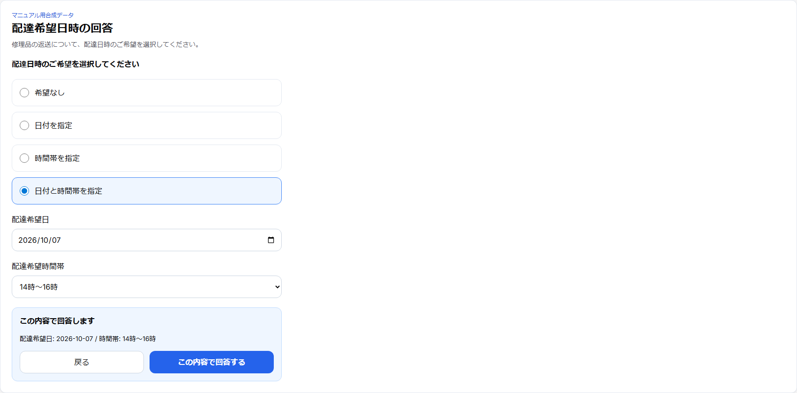

# 第21章 顧客の配達希望日時回答

## 21.1 対象と発送判断

B2Cの単一Repairは作業完了LINEから `/customer/delivery/[token]` で回答する。同じ受付で複数Repairが作成された場合は、受付後にLINEで1回案内される `/customer/repairs/[token]` の共有ページから、今回発送するRepairグループについて回答する。Repair.statusを `作業完了` にしただけではLINEは送られない。共有URLは開ける人が操作できるため外部へ転載しない。

複数Repairで完成品と未完了品が混在するときは、管理画面から発送判断を1回依頼し、お客様が「完成した時計を先に発送する」か「すべての時計が完成するまで待つ」を選ぶ。先送りなら完成分と残りを別グループとして扱い、残りは全件完了後に回答できる。全件待ちなら全件完了後に1グループとして回答する。最初から全件完了している場合は共有ページでまとめて回答する。別受付のRepairは混ぜない。

## 21.2 配達希望の回答

今回発送する対象の受付番号を確かめ、`回答内容を確認` → `この内容で回答する` の順で送信する。希望がない場合も `希望なし` を明示する。

| 回答モード | 画面表示 | 保存する内容 |
| --- | --- | --- |
| `NONE` | 希望なし | 日付なし、時間帯は「指定なし」 |
| `DATE` | 日付を指定 | 希望日、時間帯は「指定なし」 |
| `TIME` | 時間帯を指定 | 日付なし、選択した時間帯 |
| `DATE_TIME` | 日付と時間帯を指定 | 希望日と時間帯 |

日付は日本時間で過去日を選べない。単一Repairの回答は `RepairDeliveryPreference`、複数Repairの回答は今回発送するグループの `RepairIntakeDeliveryPreference` に保存する。ページを開くだけでは回答用tokenを発行しない。

## 21.3 DRAFT Shipmentへの反映

配達希望の回答が確定すると、対象RepairからOUTBOUNDのDRAFT Shipmentを同じ処理で作成・再利用し、配達希望を反映する。対象に触れる有効なShipmentがなければ新規作成し、同じ顧客・同じRepair構成の有効なDRAFTが1件だけなら再利用する。対象の重なり、余分なRepair、別顧客、複数候補、DRAFT以外は推測して更新しない。同じ回答の再送は重複個口を作らない。

単一RepairではRepair詳細の `配達希望日時の記録` から `発送候補を更新` し、回答とShipment反映状態を確認できる。`未回答`、`Shipmentへ反映済み`、`Shipment作成待ち`、`複数Shipmentのため要確認`、`複数Repair同梱のため要確認`、`Shipmentとの内容差異あり`、`発送準備進行済み` は単一Repair向けの既存パネルの表示である。複数Repairの正常なグループ回答は、共有ページの対象とShipmentのRepair構成を照合する。

## 21.4 回答の変更と発行後のロック

DRAFT中はお客様が再回答でき、同じShipmentの希望が更新される。管理者もDRAFT計画を編集できるが、その操作は顧客回答の記録を変えない。管理者の変更後にお客様が再回答するとShipmentの希望が再更新される。

`ゆうプリクラウド発行を依頼` でREADYになると通常の回答変更はロックされ、画面はLINEでの連絡を案内する。LABEL_ISSUED後の訂正・再発行は個別確認が必要である。回答・Shipment作成だけで送り状発行や実発送にはならない。
