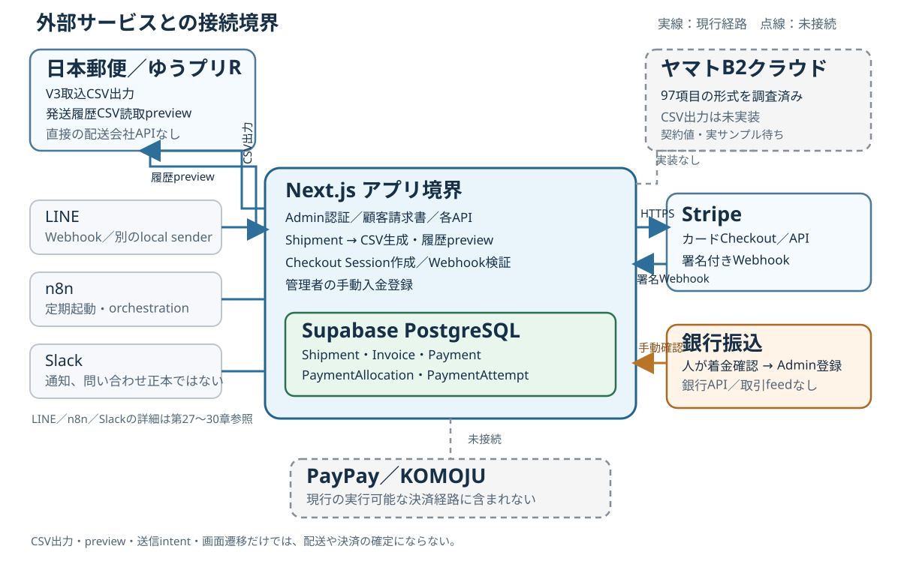

# 第34章 外部配送・決済等の接続

## 34.1 接続先と正本の一覧

この章は、外部サービスとの**現在の接続境界**を示す。CSVの出力、外部画面での操作、戻り値のプレビュー、DBへの確定は別の段階である。既存図はゆうプリクラウドWorker・追跡同期・前受金を含まない10月5日以前の構成であり、現行差分は本文で補う。

| サービス | 接続方式 | アプリ側の正本 | 状態変更・確認の責任者 | 現在の状態 |
| --- | --- | --- | --- | --- |
| 日本郵便／ゆうプリクラウド・ゆうプリR | クラウドWorkerで発行・追跡番号保存。R用CSV出力と履歴previewも利用可能 | Shipmentの宛先snapshot・発行結果・配送状態 | 発行は人が依頼。現物引渡しは担当者が確認 | **発行Worker運用中**。追跡同期コードはdeploy済み、永続同期OFF・実発送E2E前 |
| ヤマトB2クラウド | CSV adapterを調査中。現行アプリにB2出力UI・API・CSV生成はない | 配送会社非依存のShipment。B2固有の確定値は未設定 | 契約固有値と受理済み実ファイルの確認が先決 | **調査完了／実装保留** |
| Stripe | 請求書・Repair前受金のカードCheckout、返金 | Invoice、Payment、PaymentAllocation、PaymentRefund等 | 決済は署名付きWebhook、返金は結果照合で確定 | **実装済み：B2C前受金・最終請求充当・返金照合** |
| 銀行振込 | 振込そのものはアプリ外。管理者の手動入金登録API | Invoiceと`MANUAL`／`BANK_TRANSFER`のPayment | 入金を確認した管理者が明示登録。銀行APIや取引明細feedは使わない | **実装済み：手動確認・登録** |
| PayPay／KOMOJU | 現行の実行可能な決済経路には接続しない | PayPayはenum・表示ラベルのみ。KOMOJUは本Taskで確認したrepo証拠に実装参照なし | 決済確定者・連携経路は未定義 | **未実装**。将来の採用可否をここで決めない |
| LINE Webhook／LINE Manager sender | Webhook受信と、別のWindows local senderによる送信・履歴照合 | InquiryMessage等の保存済み記録、送信Outbox | Webhook processorと履歴照合。送信intentだけでは送信済みとしない | **個別に実装**。詳細は第27・28章 |
| n8n／Slack | n8nが処理を定期起動し、Slackへ通知 | 問い合わせはSupabaseのInquiry等。Slack投稿は正本でない | n8nはorchestration、Slackはnotification | **個別に実装**。詳細は第29・30章 |

## 34.2 日本郵便／ゆうプリクラウドとゆうプリRの境界

通常の発行は `/shipments` から人が依頼し、WindowsのゆうプリクラウドWorkerがCSV登録、発行、追跡番号保存、PDF取得、固定プリンタ印刷を行う。郵便局の引受は別の事実。Admin認証が必要な`GET /api/shipments/[id]/yupuri-v3`は、代替のゆうプリR標準フォーマットV3を**読取専用で生成**する。共通画面にこのCSVの出力ボタンはない。

| V3出力契約 | 内容 |
| --- | --- |
| CSV | 固定100列、headerなし、CP932／Shift_JIS、BOMなし、CRLF |
| お客様側管理番号 | `SHP-{Shipment.id}`。後の履歴候補照合に使う |
| 宛先 | Shipment作成時のdestination snapshot。Customerの現住所へfallbackしない |
| 出力時の変化 | Shipment、Repair、追跡番号、status、`labelIssuedAt`を更新しない |

荷物サイズコードは現時点で`060`固定である。実荷物が60サイズ以外なら、この値をそのまま使えると判断しない。未対応の配達希望値やCP932で表現できない文字は推測変換せずエラーにする。

Admin認証が必要な`POST /api/shipments/yupuri-history/preview`は、ゆうプリR発送履歴CSVを解析して照合候補とエラーを返す。対象はCP932・BOMなし・CRLF・headerあり6列のファイルで、`SHP-{Shipment.id}`により候補を照合する。Task202Bで公式配送status code pairの説明表示を追加した。追跡番号・日付は候補またはraw値にとどめ、**追跡番号、Shipment／Repair status、実発送日時、配達完了日時を保存しない**。重複や追跡番号競合、形式不正も自動解決しない。

`10/0A = 引受予定`を含む公式表のcode pairに説明を表示するが、**説明は実際の郵便局引受やShipment状態更新を証明しない**。このpreviewでは14バイトの日付値をparseせず、`importableLater`も書込承認ではない。別の発行後CSV同期経路で配送状態を保存するコードはproduction反映済みだが、永続同期はOFFで実発送E2E前。業務上の詳細は[第25章](25_yupuri.md)・[第26章](26_shipping-tracking-delivery.md)を参照する。

## 34.3 ヤマトB2クラウドの調査境界

Task201Bは**調査完了／実装保留**である。公式資料で取込レイアウトが**固定順97項目**であり、列の削除や並べ替えを前提にしないことを確認した。一方、必須の請求先顧客コード・運賃管理番号などは契約・設定に依存する。依頼主情報、利用サービス、header・開始行・encodingを含む受理済みの基本テンプレートまたは実サンプルも、実装前に確定が必要である。

現行repoにはヤマトB2用CSV出力のUI、API、adapter実装がない。Shipmentの共通宛先データがあることは、B2用ファイルを今すぐ出せることを意味しない。契約固有値や実ファイルの証拠が揃うまで列値・コード・文字コードを推測しない。B2固有項目は将来のadapter境界に置く方針であり、現行Shipmentの正本へ混ぜない。契約コードや実アカウント値はマニュアルへ転記しない。

## 34.4 Stripe CheckoutからWebhook確定まで

顧客向けCheckoutはB2C請求書と、Repair共有ページの前受金・部品代先払いを扱う。請求書では前受金充当後の残高を支払対象とし、処理中の決済・返金や結果不明のCheckoutを照合せずに新規決済を重ねない。画面へ戻っただけで入金確定にせず、保存されたPayment状態を確認する。

Checkout Sessionの重複防止には保存済みの決済試行と同じidempotency keyを使う。請求書・前受金ともcard Checkoutで、顧客が画面から金額やproviderを任意指定する契約ではない。顧客請求画面のwallet案内だけで利用可能性を保証しない。

保存済みSessionが開いていれば既存URLを再利用し、完了してもWebhook未確定なら結果確認中とする。Session作成・ID保存の結果が不明なときは保存済み試行と同じ条件で照合し、別のSessionを推測で作らない。URLへ戻ったことや`checkout=success`表示だけで入金済みにしない。

Stripeからの`POST /api/stripe/webhook`はraw bodyと`stripe-signature`を`STRIPE_WEBHOOK_SECRET`で検証する。署名不正や設定欠落を受け入れない。確定対象は`checkout.session.completed`で、かつ`payment_status === paid`のイベントだけである。それ以外は支払確定を行わない。

確定処理は登録済みCheckout Session IDからAttemptとPaymentを再取得し、支払種別、対象、金額、通貨、metadata等を照合する。前受金はRepairへの受領として、請求入金は前受金充当後の請求残高への支払いとして区別する。条件が一致した場合だけ`SUCCEEDED`へ進め、重複Webhookは冪等に扱う。請求残高は有効な前受金充当、請求入金、成功した返金を反映する。不整合時は入金済みと推測しない。

管理画面では未決済の前受金依頼の取消、未充当前受金のStripe返金、請求入金のStripe返金・外部で実施済みの銀行返金記録、結果不明の返金照合を扱う。銀行返金記録は送金しない。請求書取消は有効な前受金充当を解放するが、自動返金しない。返金が`PENDING`の間は新規返金や請求決済を重ねず照合する。詳細な操作は[第10章](10_customer-approval.md)を参照する。

## 34.5 銀行振込は管理者の手動確認

銀行振込の着金は、この経路では銀行APIや銀行取引feedから取り込まない。管理者が別途入金を確認した後、Admin認証が必要な`POST /api/invoices/[id]/payments/manual`でB2C（`individual`）請求書に明示登録する。登録は`Payment(provider=MANUAL, method=BANK_TRANSFER, status=SUCCEEDED, paidAt=登録時刻)`と単一allocationを作る。共通helperは発行済み請求書、正の総額・未入金残高、処理中Paymentなし、部分入金なしを確認する。

顧客請求画面に振込案内が表示されること、顧客が振込操作を行ったこと、管理者が入金済みと登録したことは別の事実である。外部の着金確認なしに手動APIを自動実行する運用はこの実装に含まれない。実際の銀行口座情報は本章・図・プレビューへ載せない。

## 34.6 PayPay／KOMOJUの現行境界

Prismaの`PaymentProvider`は`STRIPE`と`MANUAL`、`PaymentMethod`は`CARD`、`PAYPAY`、`BANK_TRANSFER`を定義する。支払表示にはPayPayラベルがあり、内部helperは`STRIPE`／`PAYPAY`の`PENDING`作成を型上受け入れ得る。しかし**現行の顧客Checkout routeは`STRIPE`／`CARD`と`["card"]`しか作らない**。enumや表示ラベルを、実際に選択・決済できる証拠としない。

KOMOJUについては本Taskで照合した現行repoの証拠に実装・参照がない。したがってPayPay／KOMOJUはいずれも**現行の実行可能な決済経路に含まれない**。これは将来の事業判断を否定する意味ではない。実装・設定・検証が実在する段階で、その契約を改めて記録する。

## 34.7 LINE／n8n／Slackへの参照

この3系統は決済・配送の確定者としてまとめない。LINE Webhookの受信・Inquiry保存は[第27章](27_line-webhook.md)、LINE Manager outboxと**別のWindows local sender**による送信・履歴照合は[第28章](28_line-manager-sender.md)を参照する。n8nは内部処理の定期起動・通知のorchestrationであり、LINE Manager送信本体ではない（[第29章](29_n8n.md)）。Slackは通知先であり問い合わせ正本ではない（[第30章](30_slack.md)）。ゆうプリRの履歴previewをLINE発送通知へ自動接続したものとして扱わない。

## 34.8 障害の切り分けと秘密情報

| 症状 | 最初に確認する境界 | この章で推測しないこと |
| --- | --- | --- |
| ゆうプリR CSVを出せない | Admin認証、ShipmentのOUTBOUND／発送前条件、宛先snapshot、配達希望値、CP932変換 | CSV未取得を郵便局側の障害と決めない |
| 履歴CSVをpreviewできない／結果が合わない | ファイル形式・header・`SHP-`管理番号、重複・追跡番号競合、raw status | `10/0A`を実引受と読まない |
| B2 CSVの利用を求められた | Task201Bの不足契約値と受理済みテンプレート／サンプル | 現在使えるB2 UI・APIがあると案内しない |
| Checkoutを開始できない | 請求書の顧客区分・発行状態・正の総額／残高、既存Payment／Session状態、Stripe Session作成結果 | success URLだけで着金としない |
| Stripe決済後も未入金 | 署名検証、paid event、登録Session／Attempt、照合不一致、Webhook処理結果、Paymentの`SUCCEEDED` | 顧客の画面遷移だけで手動確定しない |
| 銀行振込が未反映 | 人の着金確認、Adminの手動登録結果、Paymentの状態 | 振込案内の表示を着金証拠にしない |
| LINE／Slack通知の不一致 | 第27～30章のInbox、Outbox、local sender、n8nを各々確認 | Slack未着をInquiry未保存、送信intentをLINE送信済みと決めない |

調査記録、CSV例、図、印刷物に、Stripe API key・Webhook secret、内部Bearer token、共有URLの実token、LINE認証情報、実顧客情報、配送会社の契約コード、銀行口座情報を載せない。環境変数名や識別子の**種類**を説明することと、その**実値**を共有することを分ける。エラーが出た段階の正本・状態だけを確認し、未実装の連携を代替手順として作り出さない。
