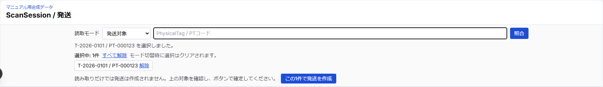
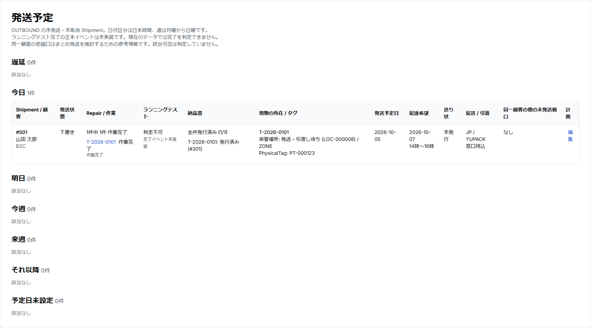

# 簡易版 19 — Shipmentを確認・作成し、予定を確認する

## 1個口を確認・作成する

お客様が配達希望を回答済みなら、同じ受付の今回発送するRepairグループからDRAFT Shipmentが自動作成・再利用される。まず `/shipments` で既存個口を確認する。以下は手動作成が必要な場合の操作。

1. 現物とRepairの問い合わせ番号・返送先を照合する。
2. ScanSessionで `発送対象` を選び、同じ1個口に入れるPhysicalTagを読む。
3. 選択中のRepairを確認し、`このN件で発送を作成` を押す。
4. 作成された発送IDを控える。

**scanだけではShipmentは作成されない。** 別顧客や返送先不一致は作成できない。作成結果が不明な通信エラーでは同じ選択を再送せず、発送予定を確認する。

## 予定を見る

`/shipments` はOUTBOUNDの未発送・未取消個口の一覧。今日・明日・今週・来週・遅延などで探し、Repair件数、納品書、保管場所、タグ、配達希望、同一顧客の他個口を確認する。

計画を直せるのは **DRAFTだけ**。発送予定日、配送会社コード、サービスコード、引渡方法、配達希望日、時間帯を編集できる。顧客がDRAFT中に再回答すると配達希望が再更新され得る。発行依頼後のREADY以降は通常変更できない。

**現在の限界:** この一覧は未発送予定の画面。ランニングテスト完了は判定不可。Shipment作成や送り状発行だけで発送済みにはならない。
